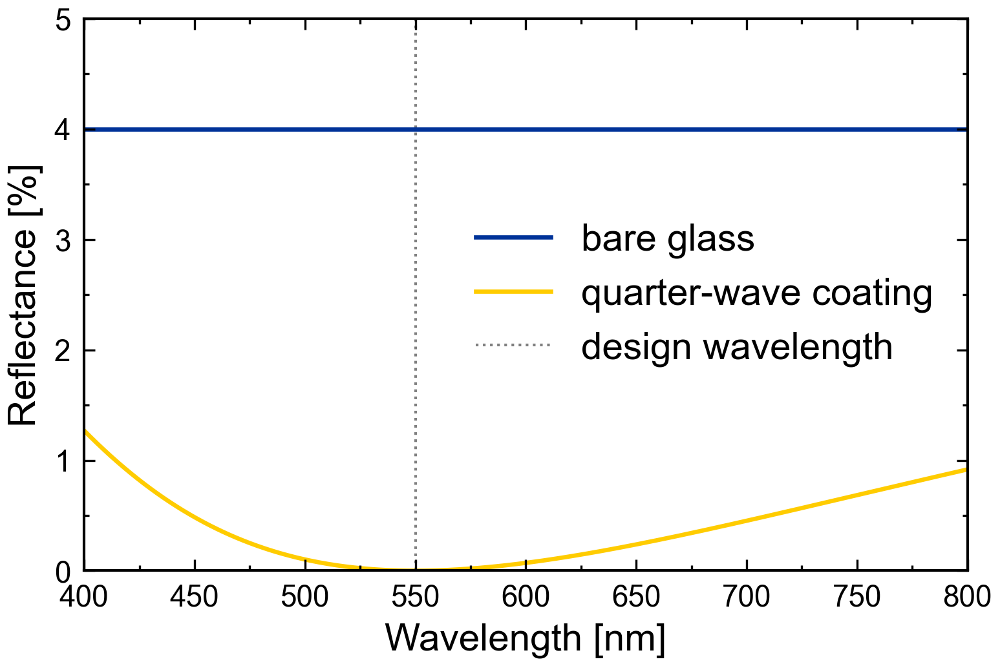
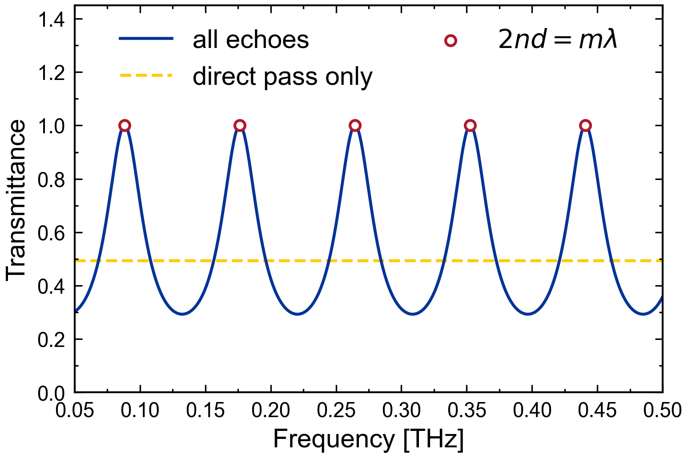
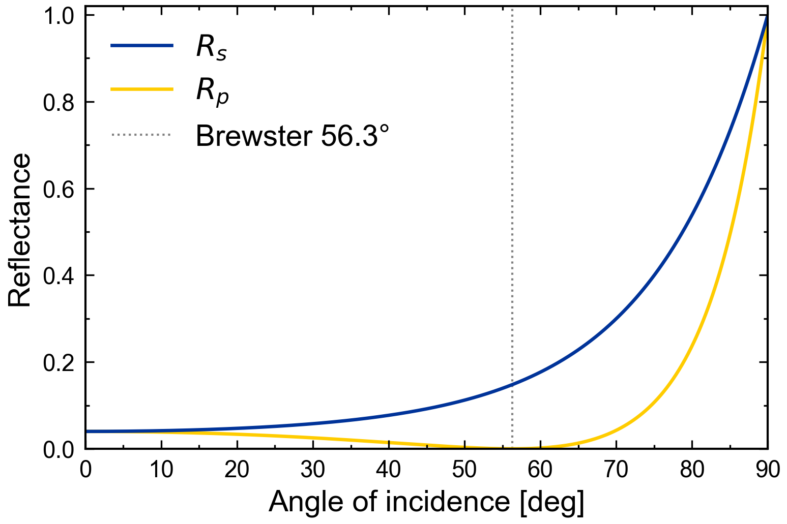
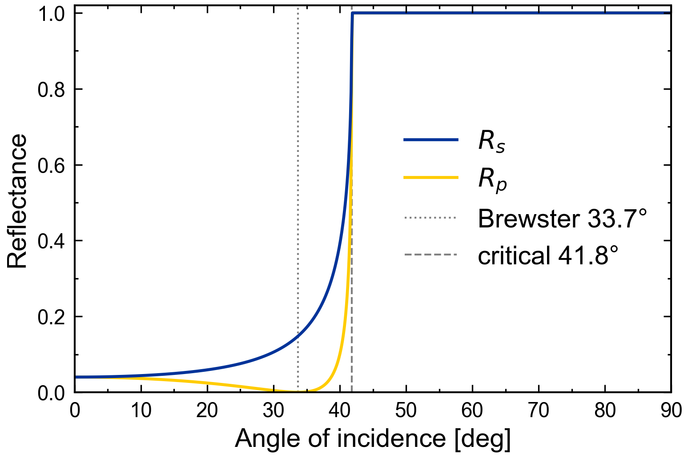
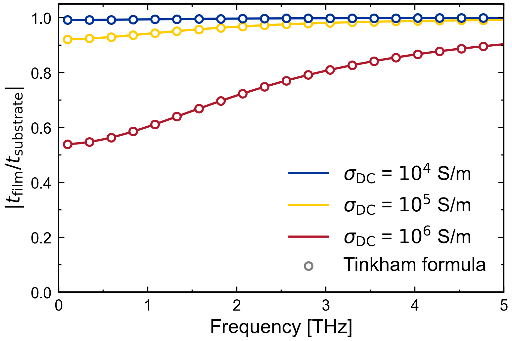

# cjctmm

[](https://github.com/cjcscheper/cjctmm/actions/workflows/tests.yml)

Transfer-matrix method (TMM) for multilayer optics: give the frequencies, the
layer thicknesses and the complex refractive indices of a planar stack, and get
its complex reflection and transmission coefficients and the reflected,
transmitted and absorbed power fractions.

- **Arrays in, a result out.** No material models, no file formats: compute the
  refractive indices however you like and pass them as an array.
- **Any frequency range.** Visible coatings, infrared filters, THz
  spectroscopy: the method has no built-in scale.
- **Oblique incidence, s and p**, absorbing layers, evanescent waves, total
  internal reflection.
- **Finite substrate passes** for time-gated measurements, with a warning when
  that approximation does not hold.
- **numpy only.**

The physics, with derivations and conventions, is in [THEORY.md](THEORY.md).

## Install

```bash
pip install git+https://github.com/cjcscheper/cjctmm.git
```

To pin a fixed version, so a script keeps giving the same numbers later on
(see [Releases](https://github.com/cjcscheper/cjctmm/releases) and the
[changelog](CHANGELOG.md)):

```bash
pip install git+https://github.com/cjcscheper/cjctmm.git@v0.1.0
```

For development, clone the repository and install it editable:

```bash
pip install -e ".[test]"
```

`requirements.txt` lists the dependencies on their own, e.g. to set up a
virtual environment or a PyCharm interpreter:

```bash
pip install -r requirements.txt
```

## Quick start

A quarter-wave antireflection coating on glass at 550 nm:

```python
import numpy as np
from cjctmm import SPEED_OF_LIGHT, solve_tmm

wavelength = np.linspace(400e-9, 800e-9, 400)
omega = 2 * np.pi * SPEED_OF_LIGHT / wavelength      # angular frequency [rad/s]

n_coating = np.sqrt(1.5)
result = solve_tmm(
    omega,
    layer_thickness=[np.nan, 550e-9 / (4 * n_coating), np.nan],   # [m]; NaN = semi-infinite
    layer_n=[1.0, n_coating, 1.5],                               # air | coating | glass
)
result.R      # reflectance, shape (400,); zero at 550 nm
result.r      # complex amplitude reflection coefficient
```

## The stack

```
  incident medium | layer 1 | layer 2 | ... | exit medium
  index 0           1         2               N-1
  thickness NaN     d_1       d_2             NaN
```

- `omega`: angular frequencies [rad/s], shape `(M,)`.
- `layer_thickness`: shape `(N,)` in metres. The first and last media are
  semi-infinite and must be NaN; the layers in between are finite.
- `layer_n`: complex refractive index `n' + iκ` per frequency and layer, shape
  `(M, N)`; shape `(N,)` for indices that do not depend on frequency.
  **κ > 0 means absorbing.** The incident medium should be lossless.

## Options of `solve_tmm`

| Option                     | Default | Meaning                                                                                                 |
|----------------------------|---------|---------------------------------------------------------------------------------------------------------|
| `polarization`             | `"s"`   | `"s"` (senkrecht = TE, E ⟂ plane of incidence) or `"p"` (parallel = TM, E in the plane of incidence)     |
| `theta_inc`                | `0.0`   | angle of incidence in the incident medium [rad], in `[0, π/2)`                                           |
| `num_substrate_passes`     | `None`  | `None`: all echoes (coherent). `N`: keep only `N` passes through the substrate (second-to-last layer)   |
| `substrate_pass_tolerance` | `1e-3`  | warn when the estimated error of `num_substrate_passes` exceeds this                                    |
| `conjugate_model`          | `False` | return `conj(r)`, `conj(t)`: the result in the `exp(+iωt)` time convention                               |

The returned `Result` is a frozen dataclass with `omega`, `r`, `t`, `R`, `T`
and `A = 1 − R − T`, each of shape `(M,)`. `R` and `T` are power fractions;
`T` is the power flow into the exit medium, not simply `|t|²`.

## Conventions

- **Time dependence `exp(−iωt)`**, so `n = n' + iκ` with κ > 0 for absorption.
  For the other convention (`n' − iκ`), conjugate your indices before passing
  them and use `conjugate_model=True` to get `r` and `t` back in that convention.
- **p sign as in Hecht, Born & Wolf and Wikipedia**:
  `r_p = (n₂cosθ₁ − n₁cosθ₂)/(n₂cosθ₁ + n₁cosθ₂)`. For air to glass (n = 1.5)
  at normal incidence `r_s = −0.2` and `r_p = +0.2`: the same physical wave,
  measured against opposite reference directions. For the other p convention
  use `-result.r`. `R`, `T` and `A` do not depend on these choices.

THEORY.md explains both and how the sign was pinned from Maxwell's boundary
conditions.

## Single interfaces

```python
from cjctmm import fresnel_r, fresnel_t, fresnel_R, fresnel_T, brewster_angle, critical_angle

fresnel_r(1.0, 1.5, 0.0, "s")         # -0.2
fresnel_r(1.0, 1.5, 0.0, "p")         # +0.2
brewster_angle(1.0, 1.5)              # 0.9828 rad = 56.31 deg, r_p = 0 there
critical_angle(1.5, 1.0)              # 0.7297 rad = 41.81 deg
```

Also available: `snell_cos_theta` and `snell_theta` (Snell's law for complex
indices), `admittance`, `propagation_phase`, and the constants
`SPEED_OF_LIGHT`, `VACUUM_PERMEABILITY`, `VACUUM_PERMITTIVITY`,
`VACUUM_IMPEDANCE`.

## Finite substrate passes

A time-domain measurement often cuts off the echoes from the back of a thick
substrate with a time window. `num_substrate_passes=N` models that: the
substrate (second-to-last layer) contributes only its first `N` passes, the
layers in front of it stay fully coherent. That is consistent only if the front
layers' own echoes all arrive within the window; `solve_tmm` estimates the
error and warns if it exceeds `substrate_pass_tolerance`. See THEORY.md.

```python
result = solve_tmm(omega, [np.nan, 100e-9, 500e-6, np.nan], [1.0, n_film, 3.4, 1.0],
                   num_substrate_passes=1)   # thin film on a 500 µm substrate, direct pulse only
```

## Examples

Each script in `examples/` saves its figure next to itself. They plot with
[cjcplot](https://github.com/cjcscheper/cjcplot), which cjctmm itself does not
need. Install both with the `examples` extra:

```bash
pip install "cjctmm[examples] @ git+https://github.com/cjcscheper/cjctmm.git"
```

or, in a clone, `pip install -e ".[examples]"`. The extra pins cjcplot to a
release tag (now `v0.2.0`), so the figures keep looking the same when cjcplot
changes.

<p align="center">
  
</p>
<p align="center">
  
</p>
<p align="center">
  
</p>
<p align="center">
  
</p>
<p align="center">
  
</p>

## License

MIT, see [LICENSE](LICENSE).
